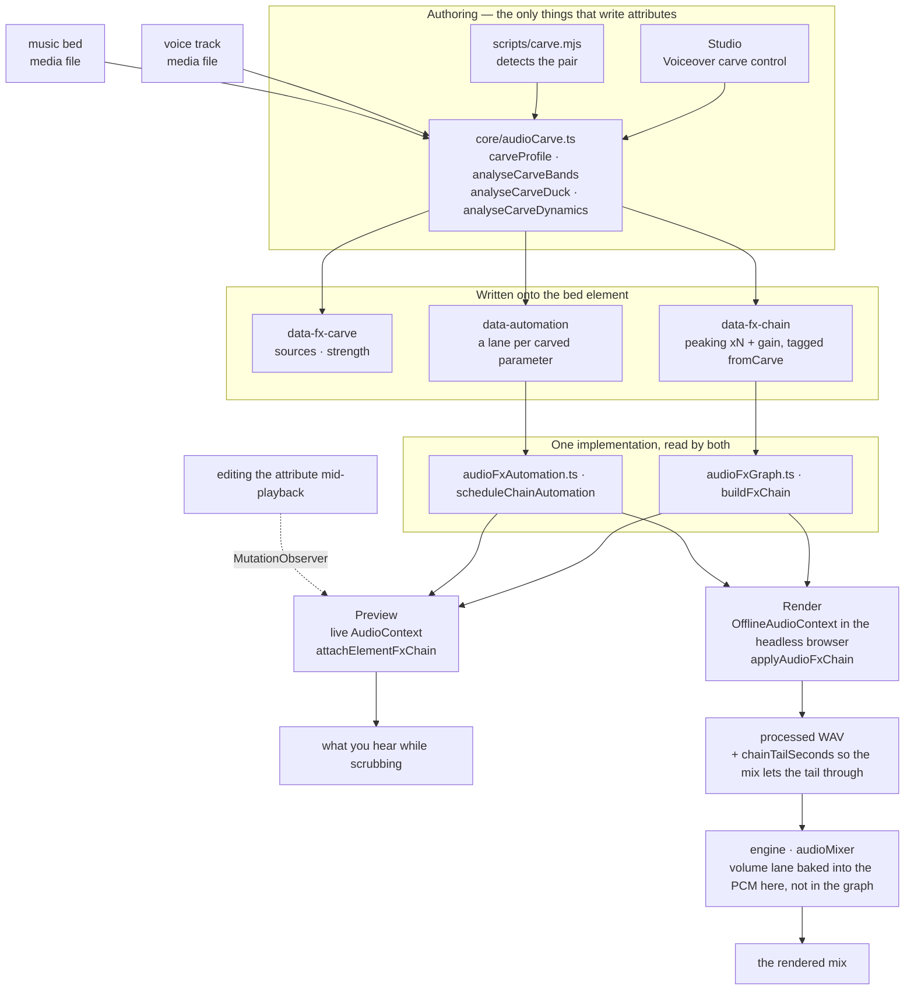
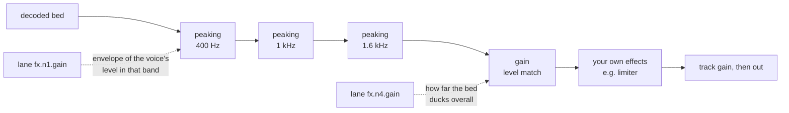

<!-- Adapted from HyperFrames (Apache-2.0, HeyGen, Inc.); modified for Cutscene. -->

# Cutscene audio

How a Cutscene video sounds: placing the user's music and the sound-effect library, then fades,
gain, automation, ducking, voiceover carve and effects. Everything runs locally.

| Need | Use |
|---|---|
| A sound effect (whoosh, click, pop, riser, impact, glitch, chime...) | the sound-effect library (files come with the engine): [references/sound-library.md](references/sound-library.md) |
| Music | the user's own file only; Cutscene has no music catalog ([references/sound-library.md](references/sound-library.md#music)) |
| Duck music under speech as a volume lane | `node "<this skill's folder>/sound/scripts/audio-duck.mjs" --meta <audio meta or transcript> --target "#music"` |
| Narration, voice lines and the promo workflows' audio pass | `scripts/sound-engine.mjs` (Kokoro or `/cutscene-voice`, local transcription, sound-effect library) |

This skill does NOT design, clone, speak or check voices and does NOT transcribe speech (that's
`/cutscene-voice`), and does NOT cut footage (`/cutscene-edit`).

## How to run cutscene commands

In this skill, `cutscene <command>` is shorthand for:

```bash
node "<this skill's folder>/../cutscene/scripts/cli.mjs" <command>
```

Replace `<this skill's folder>` with the folder this SKILL.md was loaded from. Scripts named `<this skill's folder>/scripts/...` run with plain `node`. Never call the engine through `npx`, and never use cloud commands: Cutscene works on this computer only, and it never renders a final video unless the user asks.

# Cutscene Audio

A mix is a set of relationships, not a stack of processors. Two tracks that each
sound right alone can be unlistenable together, and the fix is almost never "turn
one down" — it is finding what they are fighting over and giving it to whichever
one needs it. Every tool here exists to express one of those relationships.

Effects live on the element as `data-fx-chain`, and preview and render run the
same Web Audio graph — the studio in a live context, the engine in an offline one
inside the browser it already drives. There is one implementation of each effect,
so what you hear while scrubbing is what gets written. You never tune twice.

Clip timing remains `/cutscene-compose`: audio/video trims and source ranges use
`data-start`, `data-duration`, and `data-media-start`, and crossfades overlap
clips on different tracks. This skill owns placed-track fade-in/fade-out,
crossfade envelopes, track gain/track volume, volume and effect automation,
ducking/voiceover carve, and the effect chain. `/cutscene-voice` owns voiceover
generation and transcription; music comes from the user's own files.

Constant `data-playback-rate` (`0.1..10`) is render-safe for picture and
pitch-preserved sound when matching audio/video elements use the same timing,
source offset, and rate. A speed ramp is a `rate` lane in `data-automation`
(see `docs/reference/speed-ramps`); it wins over the constant and keeps pitch
in preview and render. Cutscene does not
provide automatic waveform sync or drift correction.
For copyable cut/crossfade/retime recipes, use `/cutscene-compose` → `references/creator-editing-recipes.md`.

Three attributes carry everything, on the audio/video element itself — or, for
the first two, on an `<hf-audio-group>` bus (see "One bus for many tracks"):

| Attribute         | Holds                                                     |
| ----------------- | --------------------------------------------------------- |
| `data-fx-chain`   | the effects, in signal order                              |
| `data-automation` | envelopes on this track's volume or its effect parameters |
| `data-fx-carve`   | the carve's own settings, so it can be re-derived         |

The shipped effect families are gain, EQ (highpass, lowpass, peaking, shelves),
compressor, limiter, truepeak (lookahead true-peak limiter), gate, saturate, delay, reverb, chorus, phaser, and bitcrush.

Exact JSON for each, and the rules a lane must satisfy: `references/attributes.md`.
Every effect with its parameters, ranges and units: `references/fx-registry.md`.
How to work out what is wrong with a file you cannot hear:
`references/diagnosis.md`.
**Presets, named jobs and one-knob profiles, plus a symptom-to-fix table:
`references/presets.md`** — read that before hand-building a chain, because one
of the presets or named jobs usually already names the problem.

## How it fits together

Two authoring surfaces write those attributes; two runtimes read them through the
same builders. That shared middle is why preview predicts the render.



The carve's own settings are never read at playback — the chain and lanes it
produced are what play. `data-fx-carve` exists so strength can be changed on an
existing carve instead of guessed back out of the filters.

Inside a carved bed the signal runs through the dips first, then the level match,
then anything you built yourself — which is why a limiter you add still acts as
the last ceiling:



## First, work out what is wrong

The table below starts from "it sounds boomy" — which presumes somebody already
listened and said so. Handed a file and "fix this", you have no such sentence
and you cannot listen, so you have to measure. One rule governs all of it:

> **The absolute spectrum of a single unknown voice cannot be diagnosed.**
> Formants are ±10 dB, fundamentals run 85–255 Hz, and sentences decline 5–6 dB
> as they end. Every one of those reads as a defect on its own, and every one of
> them is the speaker.

So compare, and compare against something **inside the same file**: the clean
original if it exists, otherwise the pauses — whatever is audible in a gap is
additive, and the gap's spectrum is the channel rather than the voice. Comparing
against a published average spectrum or a synthesised control voice does not
work: two speakers differ by more than most defects, and both wrong answers in
the evaluation behind this guidance came from exactly that.

When there is no original and no usable silence, a static tonal defect is
genuinely under-determined. Say so and offer the readings that fit, rather than
picking one and building a chain on it.

Commands, traps and worked recipes: **`references/diagnosis.md`**. Read it
before diagnosing a file nobody has described.

## Start from the symptom

Once you know the band and the kind, name what is wrong with the audio. Most bad audio is
one or two of these, and each has a shipped answer:

| It sounds like                     | Reach for                                          |
| ---------------------------------- | -------------------------------------------------- |
| Hum or thump underneath            | `rumble-cut`, or a `highpass` at 80 Hz             |
| Boomy, chesty                      | **Tame Boominess** job (200 Hz)                    |
| Muffled, behind cardboard          | **Reduce Mud** job (250 Hz)                        |
| Words hard to make out             | **Add Clarity** job (3 kHz), or carve the bed      |
| Harsh and tiring                   | **Soften Harshness** job (3.2 kHz)                 |
| Some words much louder than others | **Evenness** on a compressor, or Even Out Levels   |
| Room tone between sentences        | `room-gate`                                        |
| Voice and music fighting           | **Voiceover carve** — not an EQ on either          |
| Dry, recorded nowhere              | `room-tight` or `room-natural`                     |
| Just "amateur"                     | `voice-clean`, which is four of the above in order |

Full catalogue, what each preset contains, the band vocabulary, and what is
deliberately NOT covered (de-essing, noise removal, tone match):
`references/presets.md`.

Subtract before you add, level after you filter, relationships after level,
character and ceiling last. Each step changes what the next one hears — a
compressor set before a high-pass spends its time chasing rumble.

## Reach for a family by the problem, not the name

**Filters** (`highpass`, `lowpass`, `peaking`, `lowshelf`, `highshelf`) decide
which frequencies a track is allowed to occupy. This is the first tool for two
sources colliding, because collisions happen in bands: a bed and a voice both
want 1–3 kHz, and taking that from the bed costs the bed far less than turning
the whole thing down costs the mix. A high-pass on a voice is the standard fix
for rumble; a low-pass darkens or muffles deliberately.

**Dynamics** (`gain`, `compressor`, `limiter`, `truepeak`, `gate`) decide how a track's level
behaves over time. Compression narrows the distance between loud and quiet so the
quiet parts can come up. A limiter pulls peaks down toward a ceiling and does not
shape anything else. `limiter` follows the level and has no lookahead, so a fast
or inter-sample peak can pass its ceiling; for a delivery ceiling use `truepeak`, which looks ahead and measures the inter-sample peak. It
holds a 4x estimate at the ceiling, not the waveform itself, so full-band noise can
end up to 1.7 dB over: under a hard delivery limit set the ceiling at least 2 dB
below it. A gate removes what is below a threshold, which is
how you silence room tone between phrases. `gain` is a plain level stage, and it
is what an automation lane rides when a track has to move out of the way.

**Nonlinear** (`saturate`, `bitcrush`) changes the waveform's shape, which adds
harmonics that were not there. Reach for it when a track needs character or
grit rather than correction — and remember it is generative: it makes a thin
source denser, not cleaner.

**Time** (`delay`, `reverb`, `chorus`, `phaser`) puts a track in a space or gives
it width. These are the ones that most easily wreck a mix, because a tail or a
detuned copy occupies the same room a voice needs. Use them on the thing that
should sit _behind_ something else, and keep the wet amount lower than sounds
right in isolation.

The chain is serial: each effect processes what the one before it produced. So
corrective filtering goes early, character in the middle, and a limiter last
where it can actually act as a ceiling.

## Voiceover carve

Carve cuts only the bands a voice actually uses out of the music bed, instead of ducking the whole bed, so the music keeps its low end and top while the voice stays clear. The settings live on the bed and name the voices to listen to (as a sidechain does); never put a carve on a voice track. Carve against one group of voice clips, not a list of clip ids. A re-run replaces only its own filters and leaves hand-built effects and lanes alone.

Details: [references/voiceover-carve.md](references/voiceover-carve.md).

## Automation

A lane is a set of breakpoints on one parameter: `{t, v}` in clip-local seconds
and the parameter's own units. Targets are `volume` for the track's level, or
`fx.<nodeId>.<param>` for an effect's knob.

**Only some parameters can be automated, and a lane on the others is silently
inert.** A knob is automatable when a Web Audio `AudioParam` backs it. The
worklet-based effects — `compressor`, `limiter`, `truepeak`, `gate`, `bitcrush` — expose
none at all, so no lane on any of their parameters will ever move: to make a
compressor's behaviour change over time, automate a `gain` stage before it
instead. `references/fx-registry.md` marks every parameter.

## Verify

Almost no static gate covers the mix. The linter reads `data-automation` for
exactly one conflict — `audio_volume_double_automation`, a volume lane on a track
that also has a GSAP tween on `volume`, where the lane wins and the tween is
ignored — plus `audio_volume_tween_overrides_gain`, an authored `data-volume`
on a track whose `volume` is tweened, where the tween's values are absolute and
replace that gain instead of scaling it. Nothing validates the
chain or the effect lanes at all. What
enforces those is the render: a chain it cannot parse fails the whole mix rather
than quietly writing the dry signal, because a mix that sounds plausible and is
wrong is worse than a refusal. Preview is the opposite by design: an unreadable
chain plays dry so the composition stays workable.

A lane pointing at a node the chain does not have is pruned on read, not an
error — so a typo'd `nodeId` costs you the envelope silently. Read the ids back
out of the chain rather than assuming what was minted.

Effects with a tail (`reverb`, `delay`) make the rendered track **longer** than
its source, and the mix is told how much by the chain. So a bed with reverb no
longer ends exactly at its `data-duration`; that is expected, not a bug.

Beyond that, a mix is verified by rendering and listening. For a carve: the voice
should be legible without the bed sounding hollowed, and the bed
should come back up between phrases rather than staying flat. If the bed sounds
notched rather than simply quieter under the voice, the strength is too high —
that is the one failure mode with an obvious sound.
